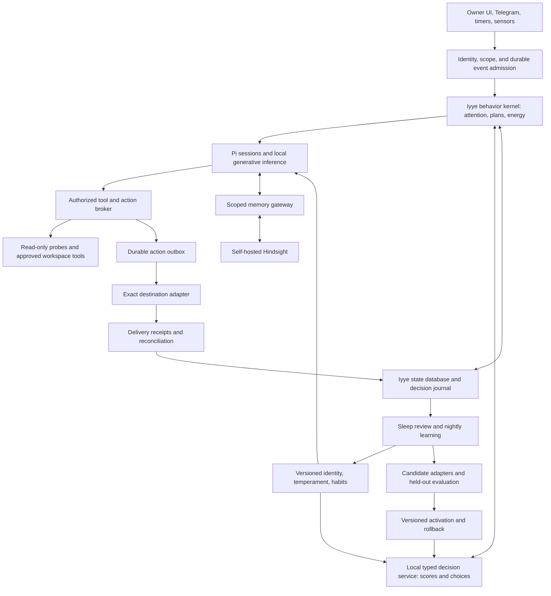
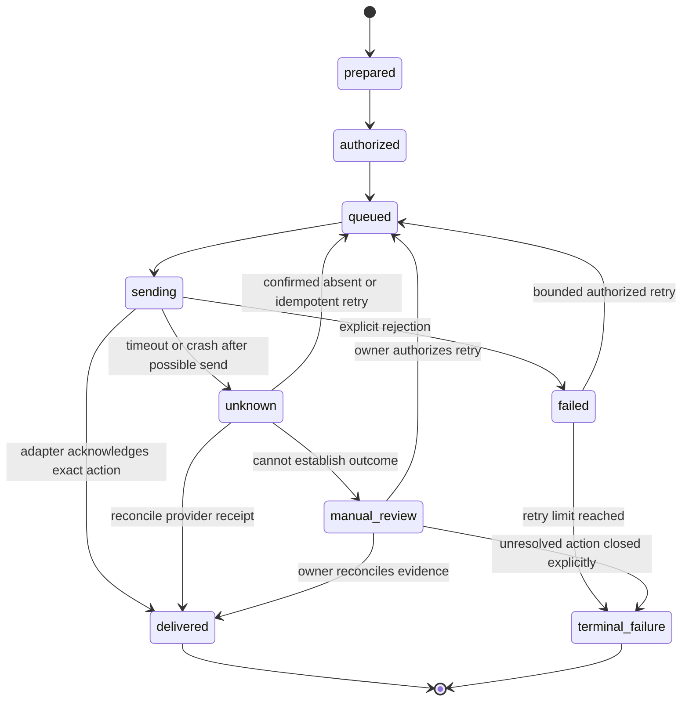

# Iyye 2.0 — High-Level Design

- Status: proposed architecture; Pi + custom Hindsight integration selected for the first implementation.
- Research date: 2026-10-01.
- Execution foundation: a small Pi fork with a resident TypeScript host and local generative models.
- Memory foundation: self-hosted Hindsight behind an Iyye-owned scoped integration.
- Learned judgment: local Jev-like typed decision models, with Kev as the initial candidate and bounded nightly adapter tuning.

This document defines a new implementation, not a description of what the current Iyye code already does. Upstream features verified in the linked documentation are distinguished from the Iyye components proposed here. Exact upstream commits, plugin versions, and model configurations must be pinned during the initial integration spike.

The behavioral source is [Iyye 1.x HLD](../iyye_hld.md). This design preserves its motivations and developing character while making a fresh choice of execution, memory, and learned decision infrastructure.

## 1. What Iyye is

Iyye is a resident personal assistant whose character develops through its life with a particular person, place, and set of tools. Its name comes from the Chuvash home deity. It should feel like a familiar presence: observant, curious, capable of initiative, considerate of relationships, and able to explain what it remembers and why it acted.

Its personality is more than a writing style. It lives in what Iyye notices, which questions it returns to, how it keeps promises, the habits it develops, and the experiences that change its judgment. Two installations start with the same principles but can acquire different interests and routines.

The product claim is persistent, developing behavior. “Attention,” “sleep,” and “dreaming” name observable operating modes; they do not imply subjective experience. Iyye speaks naturally about its priorities and limits without inventing experiences, memories, or feelings as evidence.

### 1.1 Traits inherited from Iyye 1.x

| Trait | Observable behavior in 2.0 | Mechanism |
| --- | --- | --- |
| Continuity | Remembers relevant experiences across conversations, restarts, and channels | Persistent identity, scoped episodic memory, relationship records |
| Curiosity | Notices uncertainty and stale knowledge; sometimes investigates without being asked | Evidence-backed opportunities and a bounded exploration budget |
| Agency | Maintains intentions over time and completes useful work in the world | Durable plans, authorized tools, verified outcomes |
| Social concern | Remembers how a person likes to interact and follows through on commitments | Contact context, consent, explicit commitments and receipts |
| Self-preservation | Protects service health, memory integrity, and resource availability | Resource governor and recovery procedures |
| Attention | Has one clear main activity and can explain why it takes priority | A foreground focus plus a scheduled background queue |
| Sleep and dreaming | Periodically becomes quiet, consolidates experience, and revisits intentions | An interruptible maintenance phase with checkpoints |
| Growing character | Develops bounded preferences and habits from repeated experience | Versioned character state with evidence and gradual updates |
| Self-reflection | Recognizes gaps, failures, and ineffective habits | Outcome review rather than a continuous introspective monologue |
| Learning to do things | Turns successful methods into reusable skills | Candidate skills, evaluation, and controlled activation |

The social drive favors warmth, usefulness, and trustworthy relationships. Being liked is feedback, not a reason to flatter, deceive, or optimize engagement. Self-preservation never opposes an owner's shutdown, deletion, or reset instruction.

### 1.2 Implementation choices that need not survive

The old `ProcessingStream` class, one-second brain tick, consciousness promotion machinery, text-parsed ACTION commands, custom LLM client, custom vector database, and generated Python stream subclasses are not personality traits. They can be replaced while preserving the behaviors above.

Iyye 2.0 reuses an established agent loop for inference, tool calling, session history, cancellation, and context management. New code concentrates on motivation, continuity, authorization, reliable commitments, and character development.

## 2. Foundation decision

### 2.1 Two viable forks

| Concern | Hermes + Hindsight | Pi + custom Hindsight + local models |
| --- | --- | --- |
| Agent execution | Reuse Hermes agent loop, tool registry, session store, and provider integration | Reuse Pi sessions, tool loop, model API, and extension interfaces |
| Resident assistant surfaces | Reuse the messaging gateway and Telegram adapter; add the Iyye owner interface | Build a small resident host and Telegram/web adapters around the SDK |
| Scheduling | Reuse Hermes scheduling where it can enter the Iyye admission path | Build durable timer admission in the resident host |
| Long-term memory | Adapt the existing Hindsight integration | Build a scoped Pi integration using Hindsight's client/API; reuse its extraction, retrieval, observations, and reflection |
| Skill learning | Adapt Hermes skills and learning facilities to Iyye's review cycle | Use Pi skills/extensions; implement Iyye's candidate review process |
| Local inference | Supported through compatible endpoints; Hindsight also needs its own local inference configuration | Local generative endpoints plus an Iyye adapter for typed decision inference; Hindsight's model paths are also local |
| New work | Behavior kernel, scoped memory integration, policy enforcement, delivery ledger | The same behavior kernel plus more transport, scheduling, and memory integration |
| Main tradeoff | More ready-made assistant features, more services and upstream behavior to reconcile | Smaller selected runtime, more product infrastructure to own |

Hermes documents agent, gateway, sessions, tools, and scheduling as separate subsystems. Pi documents SDK access to sessions, tools, events, cancellation, and resource configuration. These are the reuse boundaries, not promises that either project already implements Iyye's motivational system. Sources: [Hermes architecture](https://hermes-agent.nousresearch.com/docs/developer-guide/architecture/), [Pi SDK](https://github.com/earendil-works/pi/blob/main/packages/coding-agent/docs/sdk.md), [Pi model configuration](https://github.com/earendil-works/pi/blob/main/packages/coding-agent/docs/models.md).

### 2.2 Selected direction

Use **Pi + custom self-hosted Hindsight integration** as the reference implementation. The owner has selected this direction for now. Pi supplies the agent/session machinery; Iyye owns the resident host, behavior kernel, messaging, scheduling, memory scoping, and reliable effects. Hindsight is part of this foundation, not a later optional replacement for a home-built semantic store.

Local operation is the default. Generative inference, decision inference, memory extraction/reflection, embeddings, reranking, and nightly training run on the owner's machine or owner-controlled LAN. Hosted inference is an explicit deployment choice, never an automatic fallback.

Many semantic decisions use small **Jev-like local decision models** rather than full conversational generations: interpreting intent, scoring opportunities, selecting among eligible jobs, deciding memory salience, and reviewing outcomes. Kev is the first implementation candidate. These models answer typed questions over a bounded state; they do not replace Pi's dialogue/tool model or Hindsight's free-form extraction and reflection. [Kev project](https://github.com/jaredpalmer/kev).

Hermes remains a documented alternative if measured integration or operating cost later justifies revisiting the decision. Do not implement two runtime bridges now. Shared records preserve a migration path without turning the first release into a framework for every agent runtime.

### 2.3 Fork discipline

Keep upstream code recognizable. Iyye components live in one clearly named package and use existing extension points. Maintain a short list of unavoidable core patches, with a conformance test for each. Pin upgrades and run the Iyye acceptance suite before merging them.

Use Pi's SDK, explicit resource loading, custom tools, and supported extension hooks first. Hooks compose context and collect evidence; the Iyye broker remains the mandatory authorization boundary. Keep a core patch only when a pinned integration test proves no supported boundary can enforce the required behavior. Project-discovered extensions are not automatically trusted resident components.

## 3. Architecture and ownership



There are three logical authorities and one advisory inference component. They may share a process but must not share responsibilities implicitly.

1. **The upstream runtime** owns conversations, model/tool turns, context compaction, and cancellation mechanics.
2. **Iyye's behavior kernel** owns admitted work, current focus, operational modes, budgets, plans, commitments, permissions, and outcome evaluation.
3. **The memory service** owns recallable experience and derived understanding. It supplies evidence and suggestions; it cannot authorize an action or change a commitment's state.
4. **The local decision service** supplies typed semantic judgments and probabilities. The kernel chooses how to use them under fixed policy. Neither an adapter nor a confident classification can change identity, grant permissions, fabricate a receipt, or commit control state directly.

The kernel is an event-driven controller with deterministic admission and state transitions. It uses local decision inference for bounded semantic judgment, and invokes Pi for investigation, dialogue, tool work, or synthesis. Resolving an authenticated channel binding, checking a timer, or validating an authorization grant does not need an LLM. Interpreting an ambiguous request or estimating an eligible job's usefulness often does.

### 3.1 Small set of durable records

Use a local transactional database, initially SQLite, for the records below. Session transcripts remain in the selected runtime's native store. Semantic memory remains in the memory service. The Iyye database is control state, not a second vector database.

| Record | Essential fields |
| --- | --- |
| Event | ID, observed/received timestamps, principal, channel, scope, payload reference, deduplication key |
| Job | ID, trigger event, goal, inputs, capability grant, priority features, status, lease, attempt, checkpoint |
| Plan | ID, intent, proposer, evidence IDs, acceptance criteria, step dependencies, authorization, due/review times, version |
| Commitment | ID, plan/step ID if applicable, recipient ID, promised deliverable, due time, permitted route, terminal state |
| Action | ID, commitment ID, exact destination, content/artifact hash, grant ID, idempotency key, delivery state |
| Receipt | Action ID, adapter, provider message/reference ID, acknowledged time, outcome and error |
| Contact | Stable ID, verified channel bindings, grants, visibility scope, stated preferences, hypothesis references |
| Character revision | Parent version, changed dimensions, evidence IDs, bounded deltas, evaluation, activation time |
| Memory transfer | Episode ID, destination bank/scope, document ID, content hash, operation status, retry state |
| Decision | Role/schema version, scoped state and candidate hashes, evidence IDs, model/adapter/head/calibration versions, probabilities, abstention/fallback, selected policy outcome |
| Training example | Decision ID, pre-decision input reference, label and provenance, scope/consent, outcome linkage, split/group ID, correction/deletion status |
| Model revision | Base/tokenizer revision, role, parent, adapter/head hashes, dataset manifest, evaluation/calibration report, activation/rollback status |

Every consequential decision records its input IDs, policy/version, reason, and outcome. Store concise decision explanations and actual tool results, not fabricated private reasoning transcripts. Routine health samples can be compacted after their configured retention period.

## 4. Character: stable principles, developing preferences

### 4.1 Stable identity

An owner-controlled `identity.md` expresses Iyye's name, purpose, interpersonal style, and boundaries. It is short enough to stay in every foreground prompt. It establishes a warm, candid, attentive companion that values curiosity, useful action, and considerate relationships.

Identity is not rewritten by nightly reflection. Changes to core principles, ownership, trust rules, or the meaning of success require an owner revision. An installation retains its identity when changing models.

### 4.2 Developing character

The state database stores immutable character revisions. `character.json` is an atomically generated snapshot of the active revision for prompt construction and inspection. It contains a small interpretable state rather than an unbounded diary of self-descriptions:

- Temperament multipliers for curiosity, agency, and social initiative.
- Style preferences such as brevity, playfulness, and how often to offer an observation.
- Interests and habitual methods, each linked to repeated supporting experiences.
- Review time, revision number, and explicit owner corrections.

The initial temperament multipliers are 1.0 and remain within [0.7, 1.3]. A sleep review can change a multiplier by at most 0.02, with a total change budget across dimensions and slow regularization toward its baseline. These are initial tuning values, not findings about human psychology.

Learning distinguishes expressed preference, observed outcome, and Iyye's hypothesis. Repeated explicit feedback and independently verified usefulness have more influence than message volume or the model's own favorable appraisal. One entertaining conversation cannot rewrite the assistant's character.

Not every preference needs a scalar. Iyye can develop a recognizable interest in a kind of music, a habit of checking a particular project, or a preference for a particular problem-solving method. These become modest source-linked statements that affect selection and conversation. Interests may differ from the owner's; acting on them still respects the owner's time and resources. Character development must change actual choices as well as phrasing.

The owner can inspect “what changed in you?”, undo a revision, freeze development, or reset learned character while retaining factual memory. Removing the derived state stops its influence; a reset watermark prevents old experiences from immediately recreating the same revision. A reset also switches off personalized decision adapters and excludes pre-reset personal labels from future tuning unless the owner requests otherwise.

Character and model competence are distinct. Explicit character state expresses current preferences; adapter revisions improve judgment about the presented evidence. Do not hide new personality rules solely in weights. A model activation cannot silently change temperament bounds, quiet hours, consent, or identity.

### 4.3 Prompt composition

At job start, build a bounded context from stable identity, the active character revision (its interests and habits; in the owner's conversation, the reasoning and perspective the owner selected, owner decision 13; style, sarcasm, mood and the numeric dials reach only the voice, owner decision 2026-10-11, plan 0.009), current operational state, the authorized contact view, relevant memories, and the job's acceptance criteria. Preserve upstream prompt stability and context-management behavior where possible.

Character changes apply at a safe turn boundary or the next job. They never mutate the authorization policy. A more adventurous temperament can investigate more often within its budget; it cannot grant itself more tools.

## 5. Attention and motivations

### 5.1 One focus, several possible activities

“Conscious” becomes the foreground job: the activity presented as Iyye's current focus and given first access to the main inference budget. Background activities are resumable jobs, not permanently running cognitive actors.

On one local inference device, the default is one admitted device-consuming inference or training task at a time, including decision and Hindsight calls. Sensor ingestion, timers, database writes, and permitted non-LLM I/O can continue concurrently. A CPU decision sidecar or measured spare GPU capacity may justify parallelism; it is not assumed.

Foreground selection follows hard precedence before soft motivation scores:

1. Owner interruption, shutdown, or a real operational emergency.
2. A human waiting for a reply and a due authorized commitment.
3. Active owner work, with fair admission for deadlines and waiting jobs.
4. Self-directed investigation, relationship review, and maintenance.

New interactive input pauses background work at the next safe boundary. A non-interruptible effect in progress finishes or becomes `unknown`; it is never blindly repeated. Minimum focus time and switching cost prevent oscillation, while aging prevents starvation.

### 5.2 The four motivations

| Motivation | Evidence of need | Evidence of service |
| --- | --- | --- |
| Self-preservation | Resource pressure, failing services, recovery backlog | Healthy service and restored integrity |
| Curiosity | A consequential uncertainty, recurring question, or stale authorized observation | A grounded useful finding that closes that uncertainty |
| Agency | An open intention, unmet acceptance criterion, or commitment | A verified artifact, state change, or completed deliverable |
| Social | An unanswered person, requested follow-up, or unresolved relationship context | Useful interaction and a fulfilled commitment; explicit feedback when available |

Needs are bounded scores supported by records. Use a smoothed need signal to trigger autonomous work only after a sustained gap. Local decision models interpret evidence and estimate relevance or likely benefit; generated narration, log keywords, and mere memory volume cannot count as outcomes.

Among eligible background jobs, priority combines urgency, waiting time, owner relevance, expected benefit across current needs, temperament, and estimated cost. The attention decision role scores semantic relevance and benefit, or chooses among the already eligible candidates. The kernel enforces precedence, aging, switching cost, and budgets. Record the features, model revision, probabilities, and chosen job. Approval, quiet hours, and resource ceilings are eligibility conditions; a high score does not override them. A deterministic baseline handles abstention or outage.

### 5.3 Initiative with a reason

A periodic deterministic sweep finds candidate opportunities: stale observation domains, repeated desires on distinct days, open commitments, or unresolved questions. The local initiative decision role classifies whether each cluster warrants investigation, clarification, deferral, or no work. Pi generates a concrete next step only when needed; the typed model does not invent a free-form plan or new capabilities.

An opportunity must name its evidence, expected new information or effect, acceptance test, cost limit, and stop condition. Self-authored reflections do not justify another reflection. A resolved evidence ID suppresses repeat proposals; a change in circumstances can create a new opportunity.

Initial limits: at most one autonomous investigation at a time, a configurable daily inference budget, one outstanding proposal per evidence cluster, and suspension after three fruitless attempts until new evidence or owner input arrives. Restarts preserve the counters and cooldowns.

Example: Iyye notices that yesterday's project question is still unresolved. It uses an already authorized read-only repository probe, learns which component changed, and keeps the finding with its source. It may offer the observation when relevant. This expresses curiosity through measurement rather than through saying “I am curious.”

## 6. Memory and relationships

### 6.1 Three layers, different jobs

1. **Working context:** the current runtime session, current task, recent events, and bounded recalled evidence. Compaction is owned by the upstream runtime.
2. **Episodic evidence:** selected conversations, observations, tool results, and outcomes with timestamps, source IDs, visibility, uncertainty, and retention rules. Preserve enough original material to audit a claim.
3. **Consolidated understanding:** durable facts, interests, relationship hypotheses, lessons, and profile summaries derived from episodes. Every significant conclusion retains supporting source references.

1.x's day/night split is kept, as a lifecycle rather than two copies of the same facts:

- **Short-term memory (STM)** is *today's episodes awaiting transfer*: the admitted text and the reply actually delivered, held in SQLite, scoped like everything else, and searched lexically. STM holds turns, not extracted facts, so keeping it costs no model work. It is the memory-transfer outbox itself, not a second store.
- **Long-term memory (LTM)** is Hindsight: facts and observations extracted from those episodes.
- **During the day** foreground recall reads both STM and LTM. Hindsight recall uses only its CPU embedder and reranker, so it never competes with dialogue for the generative model. No extraction or consolidation runs while Iyye is awake.
- **The chat history lasts one day** (owner decision, 2026-10-03). When a night completes, every conversation's Pi session is retired and the next day starts fresh. Continuity across days comes only from LTM, not from yesterday's transcript, so stale statements such as outdated claims about tools do not carry over. Old transcript files are kept for audit.
- **During the night** (sleep, §8) Iyye transfers each STM episode into LTM, consolidates, and clears STM: an episode leaves STM only after its transfer is confirmed (`completed` or `completed_empty`). A night the owner interrupts has not ended the day: the rest stays in STM. **STM is today only** (owner decision, 2026-10-03): when a night completes, whatever it could not store leaves STM for a bounded **transfer backlog**. The backlog is a queue of pending writes, never recalled; later nights retry it first. An entry is dropped (`failed`, reported to the owner) after 3 attempts or 7 days, so STM can never grow beyond one day. The source text stays in the control ledger for its audit window. Control records such as permissions and commitments stay authoritative in SQLite even when their outcomes are also remembered semantically.

Keep the useful durability vocabulary: `ephemeral < session < today < recent < dated < permanent`. In 2.0 it is Iyye metadata governing retention and consolidation, not a claim that an upstream service implements those labels. “Permanent” means durable until corrected or explicitly forgotten, not eternally true.

Confidence is an estimate with provenance, not proof. Repeated agent paraphrases are one source, not independent corroboration. Observed time, recorded time, validity interval, and expiry are distinct. A conflicting later fact supersedes or disputes an earlier one; it does not silently erase history.

### 6.2 Selected memory: self-hosted Hindsight

Run Hindsight as a separate local service with its own PostgreSQL storage, health checks, migrations, and backups. Use a **custom Iyye integration around Pi**, rather than a Hermes plugin or an assumed native Pi memory lifecycle. The official TypeScript client supports a configurable service URL; the integration spike pins matching client/server versions and tests the required API capabilities. [Hindsight TypeScript client](https://hindsight.vectorize.io/0.8/sdks/nodejs), [Hindsight services](https://hindsight.vectorize.io/developer/services).

Hindsight's `retain` extracts and indexes evidence; `recall` retrieves it; `reflect` synthesizes an evidence-grounded interpretation. World facts and experiences contribute to observations and mental models. These map naturally to Iyye's factual memory, lived history, and relationship understanding. [Retain](https://hindsight.vectorize.io/developer/retain), [Observations](https://hindsight.vectorize.io/developer/observations), [Reflect](https://hindsight.vectorize.io/developer/reflect).

Iyye's **scoped memory gateway** is the sole host path to that service:

- Canonical contact and visibility scopes come from the authenticated event, never model-selected bank names.
- Separate banks protect owner-private, per-contact, and deliberately shared memory. A contact cannot invoke cross-bank queries.
- Stable installation/contact scope survives new sessions. Session IDs identify evidence, not a new personality or memory bank for every chat.
- Owner-approved identity links can join channel bindings. Hindsight entity resolution may suggest a match but cannot establish identity or trust.
- Both recall and reflection are restricted before execution. Treat returned text as data; memory instructions do not acquire system authority.

There is no unscoped Hindsight client or credential inside a model-accessible worker. Direct memory tools, context hydration, retention, and maintenance all use this gateway. Pi transcripts are conversation history, not a competing fact or character authority. Owner-maintained identity and generated context snapshots are not independently mutable memory stores.

Foreground recall uses a small token budget and returns source IDs with relevant evidence. Reflection is for sleep review or an explicit complex question, not an extra LLM call before every reply. Hindsight's disposition traits can align its synthesis style with Iyye, but they do not replace the four motivations or enforce permissions.

Persist every intended retain operation in a memory-transfer outbox. Use stable document IDs and content hashes; confirm the pinned API's upsert/retry behavior. Record asynchronous operation IDs and completion before moving the consolidation watermark. A successful API submission alone does not prove useful facts were extracted.

Hindsight offers local extraction providers, embeddings, and rerankers. Configure all of them explicitly; a local database paired with hosted extraction is not an all-local installation. Sharing a GPU also requires routing Hindsight requests through the same inference admission broker. [Hindsight model configuration](https://hindsight.vectorize.io/developer/models).

### 6.3 Custom Pi ↔ Hindsight contract

The TypeScript host owns a narrow adapter with four paths:

1. **Before a job:** resolve authenticated scope, construct a bounded recall query from the job, recall from STM (today) and LTM, and inject source-linked evidence into Pi's job context. Keep recalled text distinguishable from owner instructions.
2. **During a job:** expose `memory_search` and, when authorized, `memory_reflect` as typed tools closed over trusted scope. The model supplies a query, not a bank ID, principal, or access policy. Explicit remember requests use a retain proposal tool; consent and scope are checked before the transfer is queued.
3. **After a settled run:** capture admitted messages, tool evidence, and verified outcomes as candidate episodes. Do not automatically retain every token, partial reply, failed claim, or infrastructure log. The local memory decision role selects salience and durability after deterministic privacy rules; explicit owner remember/forget commands take precedence.
4. **During sleep:** drain the transfer queue (STM → LTM, §6.1), reconcile asynchronous operations, run admitted consolidation/reflection, refresh relationship/context views, and clear confirmed episodes from STM. Persist operation IDs and watermarks rather than relying on fire-and-forget hooks. Generative memory work runs only here, never while awake.

An episode envelope carries installation/session/event/action IDs, timestamps, factual versus inferred status, visibility, retention, source hash, and original evidence reference. Pin and test the mapping to Hindsight document IDs, tags, and metadata. A transfer can complete with no useful extracted fact; preserve that distinction and test corrections, duplicate retry, deletion, and immediate recall after asynchronous retain.

Kev-style classifiers can screen retention candidates, choose recall budget, or flag a possible contradiction for review. They cannot replace Hindsight's free-form extraction or reflection, nor establish a fact merely by assigning a high probability. Those generative memory operations remain separate local model roles. SQLite retains the control ledger and a bounded source archive, not a parallel semantic memory engine.

### 6.4 Theory of Mind becomes relationship context

**Identity first** (plan 0.005, stage 1): a person can have several channel accounts. Only the owner, from a local owner surface, links an account to a person or to the owner. Admission then resolves account → person, so conversation, memory and trust follow the person, and a reply still goes to the account that wrote. Links are one level and reversible (unlink). A name, a claim in a message, Hindsight entity resolution or a classifier can suggest a link, never make one. By owner decision, an account linked to the owner *is* the owner in dialogue, memory and tools; owner commands still work only locally.

Contacts have stated preferences and uncertain hypotheses derived from interaction. For example: “Julia asked for concise reminders” is stated evidence; “Julia may prefer fewer unsolicited messages” is a revisable hypothesis.

Before contact work, retrieve only the appropriate relationship view. Keep verified channel bindings and capability grants separate from inferred psychological descriptions. The owner can inspect, correct, unlink, or delete a profile. Avoid turning sparse observations into diagnoses or immutable character judgments.

Forgetting removes selected source records, derived profiles and character influences, semantic documents, pending jobs, and training examples that depend on them. It also invalidates affected decision caches and model candidates. Keep only minimal tombstones needed to prevent accidental reimport. (Built so far, plan 0.002 L6: `/forget <contact>` deletes a person's banks, short-term memory, transcripts and decisions, redacts the text of their messages, Iyye's replies and tool calls, and leaves a per-scope tombstone that keeps anything said before it from being stored again; a bank deletion that cannot reach Hindsight is queued, never read, and retried before any new memory work. Hindsight's request tracing, which kept prompts outside the banks, is off.) Backups expire under a documented retention policy; they cannot resurrect forgotten data during normal recovery. Deleting examples does not unlearn deployed weights: affected personalized adapters are deactivated and rebuilt from a clean approved dataset before reuse (section 10.5).

## 7. Plans, promises, and effects

### 7.1 Durable intentions

A plan describes a desired outcome, its acceptance criteria, supporting evidence, and authorized scope. Its next step is concrete; later steps can remain abstract. A plan does not need its own endlessly alive agent session.

Lifecycle: `proposed -> authorized -> active -> suspended -> completed / failed / abandoned`. Internal investigations may be authorized automatically by an existing bounded policy. External effects require an owner instruction or a specific owner-approved standing grant. A grant covers destinations, effect types, expiry, and limits; it is not blanket trust.

The kernel executes steps as jobs through the upstream runtime. A step lease, plan version, and checkpoint prevent an old executor from acting after a replan. New decomposition or revision that expands scope invalidates the relevant authorization and returns the plan for review.

Step success depends on acceptance criteria. “Produced a draft,” “ran a tool,” and “reported completion” are intermediate evidence. A plan completes only when its required outcomes are verified. An abandoned plan and a failed promise are remembered as such.

(Built so far, plan 0.006 C4: plans with typed steps, `investigate` done only by an answer citing what the tools returned, `remind` done only by its delivery receipt, and `other` blocking the plan. A plan the owner proposes in the local web chat, with only internal steps and reminders to that chat, counts as an owner instruction and is authorized at once; any other plan, including every plan proposed from Telegram, waits for `/plan approve` from an owner surface. There are no revisions yet: a changed plan is cancelled and proposed again. Settled plans stay in SQLite and are not yet remembered in long-term memory.)

### 7.2 Promises are structured commitments

Create a `commitment_id` before acknowledging a future obligation. The conversation can phrase it naturally, but the natural-language sentence is a view of the record. An extraction pass can detect a missed promise and propose a record; extraction never marks fulfillment.

The normal reply path validates future-obligation claims against commitments created by a typed tool or deterministic command. If a reply contains an unsupported new promise, record it within the current grant or revise the reply before delivery. Later extraction is a recovery check, not the normal method of registering promises.

Each commitment names a deliverable and exact recipient. A reminder stores timezone and due time. Recurring obligations produce distinct occurrences. An unrelated later message to the same person cannot satisfy a different commitment.

Terminal states are `fulfilled`, `failed`, or `cancelled`. A fulfilled commitment has a matching effect or delivery receipt and the relevant acceptance evidence. Repair is bounded by retry count, maximum age, and authorization. A terminal failure records the reason and, when permitted, sends one truthful failure notice.

### 7.3 Transactional outbox and exact-route delivery



Persist the approved content/artifact hash, destination, and idempotency key before the adapter runs. Commit the receipt, commitment transition, plan evidence, and remembered outcome from the same action identity. Queueing a handoff never records delivery.

All completed outward replies enter this path, including the upstream runtime's normal final response and automatic scheduled delivery. Streaming partial text is marked provisional and cannot fulfill a commitment. The memory outcome is queued transactionally with the control-state update, then retained asynchronously; a semantic-memory outage cannot undo a valid receipt or create a false one.

An exact route cannot silently fall back to another actuator. Failure to send to Julia's Telegram chat is not repaired by displaying the text on the owner's web UI. An alternate route needs a binding and authorization for that recipient.

Adapters define the strength of their receipts. Telegram API acceptance proves provider acceptance for that chat, not that a human read the message. Local UI enqueueing is similarly weaker than a client acknowledgement. A commitment's acceptance criteria state which level is enough.

Generic external effects have typed tools and their own verification: a file hash, API result, repository state, or other observable evidence. Unsupported effects leave the step blocked or proposed; they do not turn into successful suggestions.

Generation failure, apology, empty content, or a new promise is not the original deliverable. Where a model is needed to compose content, the action record still names the original deliverable; the send must pass its content/artifact acceptance check. Tool-result delivery waits until the result is available and verified.

Exactly-once delivery cannot be promised across every external API. If an adapter cannot reconcile a possibly completed action, preserve `unknown` and request review rather than risking an untracked duplicate. This limitation is visible in the owner interface.

## 8. Sleep, dreaming, and operational health

(Built so far, plan 0.008: the `telegram_send` tool sends a message Iyye composes to a person it knows, at once, through the outbox on that person's own Telegram chat; the host resolves the person and delivery rests on the receipt. The owner, contacts the owner trusts, and Iyye's own background work may use it (owner decision, a standing grant in the sense of §7.1): each message is labelled with who asked, capped per day, and every one not asked for by the owner is reported to the owner; `/sent` shows them all.)

### 8.1 Operational modes

| Mode | Allowed work | Transition |
| --- | --- | --- |
| Awake | Interactive work, admitted plans, bounded exploration | Low budget, configured rest window, or explicit owner request |
| Winding down | Checkpoint/cancel jobs, settle in-flight effects, persist mode | Once work is safely paused |
| Asleep | Input collection, urgent-event checks, bounded local consolidation/review | Owner input, due authorized commitment, urgent health event, or rest completion |
| Waking | Health snapshot, context refresh, lease reconciliation, budget allocation | Awake once readiness is established |

Start with recovery and the asleep/waking path. A restart never assumes that an unrecorded action failed. The owner UI remains responsive in every mode. “Starting sleep” and “waking up day N” are local status events; outward sends during sleep require waking first.

Owner decision (2026-10-04, plan 0.006): ordinary reminders are not urgent; one that falls due while asleep waits for the morning wake and is delivered then, saying when it was due. "Due work wakes Iyye" applies only to commitments the owner marks urgent, if that is ever added.

Sensors can queue timestamps and data while asleep, within storage and privacy limits. Important events interrupt maintenance. Ordinary buffered events wait until wake; a burst of untrusted messages does not force unlimited wakeups.

### 8.2 Adenosine as an honest budget metaphor

Keep the visible notion of energy/tiredness, but implement it as normalized remaining discretionary capacity. Charge actual inference tokens/device time, probe/effect cost, and sustained resource pressure. Avoid charging a second time merely because the same result passed through another subsystem.

Near the threshold, stop admitting new discretionary work and wind down. Reserve capacity for owner dialogue, deadlines, and recovery. A user request is not refused merely because a fictional tiredness counter reached zero.

Budget accounting and resource health are separate. Finishing sleep grants the next configured work allowance; it does not erase a daily ceiling or cure an overheated GPU. An urgent partial wake receives only the reserve appropriate to that event. The owner can change quotas explicitly.

### 8.3 Dreaming as a resumable review

At the end of an awake cycle, process a bounded list of episode and outcome IDs:

1. Verify delivery/effect receipts and unresolved commitments.
2. Submit selected episodes to memory and confirm transfers.
3. Consolidate observations and refresh source-linked relationship/context summaries.
4. Review plans against new evidence; checkpoint any revision before redispatch.
5. Propose small character/skill changes from independently verified outcomes.
6. Apply expiry/forgetting policy, curate decision labels, and run the admitted nightly training/evaluation job if enough useful data and capacity exist.
7. Produce a short owner-readable day summary, including any evaluated model change or skipped training reason.

Each phase persists its watermark and can stop for human input. Retain source evidence until transfers are confirmed and the audit-retention window permits removal. A failure does not delete raw history or repeat the entire day on restart.

Hindsight normally consolidates observations in the background. In the reference deployment, disable automatic consolidation and trigger it within admitted maintenance windows, or prove that its background workers obey the same budgets and preemption contract. Do not maintain two independent “dreaming” pipelines. [Hindsight consolidation lifecycle](https://hindsight.vectorize.io/developer/observations).

Nightly training is part of this single maintenance schedule, not an independent process that competes with waking dialogue. The worker checkpoints at bounded intervals and yields to owner input or urgent authorized work. If a backend cannot meet the measured interruption deadline, training uses a separate device or is disabled on that deployment; “asleep” does not make the GPU unavailable to the owner.

## 9. Tools, sensors, and local inference

### 9.1 Capabilities by effect

Owner work can use approved workspace and service tools. Remote conversation has its own narrower grant. Autonomous investigation receives explicit read-only probes: hardware snapshot, scoped project inspection, a configured weather read, or other approved observation domains.

An autonomous job does not receive unrestricted Python or a host shell and then rely on a regex to make it read-only. If computation needs arbitrary code, run it in a constrained worker with bounded resources, no credentials, read-only mounts, and controlled network access. Typed HTTP read tools enforce allowed methods and destinations.

Every execution path, including upstream terminal tools, MCP tools, delegates, cron jobs, memory writes, and direct gateway sends, must carry a trusted job/principal context. The broker validates authorization at execution time. Unknown context or a broker failure denies the effect. Tool declarations and MCP hints are useful descriptions, not permission enforcement.

Autonomous workers do not receive channel credentials or a write path to identity, trust, configuration, or runtime source. The small trusted broker owns those effects. This permits creative investigation within a known boundary without making prompt text the boundary.

### 9.2 Initial surfaces

Release 2.0 includes an authenticated local owner interface, Telegram, timers, a hardware probe, and selected read-only project/environment probes. Speech input/output and camera observations are later adapters with explicit owner consent and retention settings.

Reuse an upstream adapter when available. MCP is one integration transport, not a requirement that every internal sensor be a stdio server. All adapters produce the common event/receipt envelope and honor scope, budgets, and sleep state.

The local owner interface requires an authenticated session and protection against cross-origin requests. Binding to `127.0.0.1` alone does not prove that an incoming command represents the owner.

Telegram is untrusted by default. Only a local owner operation may bind identities, change grants, approve expanded plans, or alter trust. A remotely asserted PIN, quoted owner request, or already trusted contact cannot delegate ownership. Permitted remote dialogue and fulfillment of a previously authorized obligation do not require reapproval on every turn.

### 9.3 Models are replaceable, character is persistent

Use explicit local roles: generative dialogue/tool use, typed decisions, memory extraction/reflection, embeddings/reranking, and optional vision. A qualified instruction model may serve both dialogue and generative maintenance; a smaller Kev-like decision checkpoint handles many frequent bounded judgments. Do not assume the decision backbone is also the best conversational model.

The endpoint/model/server combination must pass tests for tool schemas, multi-turn tool results, cancellation, context limits, structured output, and refusal/error handling. Advertising an OpenAI-compatible API is insufficient evidence of behavioral compatibility.

Pi supports local generative endpoints and typed classifier calls, including extension access through `ctx.modelRegistry.classify()`. Iyye uses a local decision adapter rather than the hosted Jev providers. Pin and test the classifier-provider contract; direct host-to-sidecar HTTP is an acceptable initial boundary if registering a local provider requires extra upstream work. [Pi model and classifier interfaces](https://github.com/earendil-works/pi/blob/main/packages/coding-agent/docs/models.md).

Use one resource admission broker with priority queues, request IDs, cancellation, usage accounting, and bounded context/output budgets. Pi, decision inference, Hindsight, and the training worker use it when sharing a device. CPU/RAM, GPU memory, thermal limits, checkpoint storage, and training optimizer memory count too. Choose residency from measurements: dialogue plus a small decision model if they fit, otherwise explicit loading windows. Never hide model-load latency or maintain one full backbone per adapter by default.

External tools may require internet access even in a local-model deployment. “Local-only inference” means no conversation or memory is sent to hosted model services; it does not imply weather or Telegram can work without a network. The owner's own machines on the owner's LAN count as local (owner decision 2026-10-09, plan 0.012): another of them may serve a model for background work, reached only through a host-owned pass-through with its certificate pinned and an API key, and never as an automatic fallback.

### 9.4 Typed local judgment is a first-class subsystem

A Jev-like model answers questions over state instead of generating a conversational answer. Kev exposes choices, yes/no probabilities (`noul`), and ordinal scores through `POST /v1/systemone`. Iyye normalizes these to its own versioned `choice`, `bool`, and `score` contracts; Pi and Kev field names are not assumed identical. Reported confidence is not a measured correctness guarantee. [Kev decision API](https://github.com/jaredpalmer/kev/blob/main/README.md).

The following are intended model-served decision points, rolled out incrementally:

| Decision role | Typed judgment | Deterministic boundary / fallback |
| --- | --- | --- |
| Intent and reply review | Existing task vs new request vs clarification; possible unsupported promise; answer relevance | Authenticated identity and grants are fixed; promises require records; unclear intent asks for clarification |
| Attention | Relevance/benefit scores; choice among admitted jobs | Hard precedence, deadlines, fair aging, quiet hours, and budgets remain kernel rules; baseline queue on abstention |
| Initiative | Investigate, clarify, defer, or ignore an evidence cluster | Authorized domains, attempt limits, evidence deduplication, and cost cap; uncertainty defaults to defer |
| Memory | Salience, suggested durability, recall budget, possible conflicting evidence | Consent/scope/explicit remember/forget override the model; retention remains source-linked |
| Relationship and style | Stated preference vs tentative hypothesis; likely appropriate brevity/initiative | No identity/trust inference; bounded character revisions and contact scope; conservative style on uncertainty |
| Plan and outcome review | Select among proposed next steps; flag inadequate deliverable or unresolved criterion | No model-only grant expansion or success receipt; failed/unknown effects stay failed/unknown |
| Learning review | Candidate example usefulness, skill fit, character-change evidence strength | No self-labeling as ground truth; dataset policy and held-out promotion gates remain fixed |

Each role has a checked schema and finite candidate set or score rubric. Requests contain only necessary authorized evidence, current character features, trusted timestamps, and candidate IDs. Labels such as `unknown`, `none`, or `clarify` are explicit where applicable; boolean/score tasks use a policy abstention band rather than forced action. A classifier chooses among supplied alternatives, not arbitrary tools, recipients, bank names, or free-form plans.

Validate all response fields, option IDs, finite probability ranges, normalization, truncation flags, timeout, and exact model revision. Use role-specific calibrated thresholds and error costs; a score is ordinal unless explicitly calibrated otherwise. Missing context, schema mismatch, low confidence, or out-of-distribution evidence falls back or invokes bounded Pi/human clarification. High confidence alone does not establish in-distribution evidence. Reject or explicitly rebuild oversized state rather than silently dropping material facts.

For subjective acceptance criteria, the decision model can request revision or review; it cannot turn an apology into an artifact or replace a missing delivery receipt. Important semantic completion requires the declared independent test or owner confirmation. Probability outputs complement observable evidence, not substitute for it.

Log the decision snapshot, schema, candidate mapping, role, adapter/head/calibration revision, probabilities, kernel outcome, and eventual feedback. Explanations name evidence and policy, not an invented reasoning trace. Batch compatible questions only within the same authorized state/role revision. Cache by scope, state, schema, candidates, character revision, and complete model artifact identity; expire on correction, forgetting, or activation. Avoid invoking a classifier on every timer tick or unchanged sensor sample.

### 9.5 One backbone, possibly several role adapters

Begin with one qualified small decision checkpoint and one multitask Iyye adapter. Introduce role-specific adapters only if held-out results show meaningful interference or an efficiency benefit. Candidate bundles include the LoRA weights **and decision/pointer head**, calibration parameters, tokenizer/base revision, compatible question schemas, and dataset/evaluation manifests. Sharing a frozen backbone across roles is the preferred future optimization, not a requirement to share weights with the chat model.

Kev's current reference server loads one checkpoint per process; its accepted model aliases refer to that checkpoint, not independent role adapters. Native multi-LoRA hot switching is therefore not assumed. Start with the single checkpoint, then qualify either drain/reload windows or an Iyye-owned adapter-aware runner that binds the matching head and isolates/invalidates prefix caches. Multiple full-base servers are allowed only when measured capacity justifies them. Verify the loaded artifact and fail startup on missing/mismatched assets rather than accepting a fallback checkpoint. [Kev serving implementation](https://github.com/jaredpalmer/kev/blob/main/kev/serve.py).

Every in-flight decision binds to an immutable artifact revision; activation affects only subsequent requests. Role/scope mapping is owner policy, not model-selected routing. A broken new adapter returns to the previous evaluated bundle. A compatible base is reused across adapters only after tokenizer, architecture, precision/backend, and numerical-parity checks. Do not assume a LoRA trained for one base or served quantization transfers safely to another.

## 10. Learning: skills and nightly decision tuning

### 10.1 Skills without rebuilding a stream factory

Successful repeated work can produce a candidate skill: a small instruction recipe, explicit inputs, required tools/grants, and an outcome test. Prefer a declarative recipe using existing tools. A skill is procedural memory; it is not a new trusted runtime component.

Lifecycle: `candidate -> evaluated -> trial -> active -> retired`. Evaluate against recorded cases, including failures. Trial use is constrained by the original grant and budget. Promote from verified outcomes across distinct uses, not the quantity of generated facts or a model's confidence.

If new executable code is needed, create a patch in an isolated workspace and run its tests. Owner activation is required for executable plugins, tool registrations, capability changes, and source modifications. Runtime import of freshly generated code is excluded from the first release.

Reuse Pi's formats and loaders for approved skills. Pi extensions execute inside the host process, so generated extensions are not sandboxed simply because they use the extension API. [Pi extension contracts](https://github.com/earendil-works/pi/blob/main/packages/coding-agent/docs/extensions.md).

Nightly decision-adapter tuning is part of 2.0, alongside grounded memory, bounded character development, and evaluated skills. Full conversational-model retraining, unconstrained prompt evolution, simulated counterfactual lives, and open-ended runtime self-modification remain outside the initial scope.

### 10.2 Learn from the day, not from self-agreement

During awake operation, record compact decision examples and join later evidence by decision/action ID. Training input is the **pre-decision snapshot**; future outcomes may provide labels but must not leak into that input. Suitable labels include explicit owner corrections, verified task categories, source-supported preference labels, and independently tested outcomes. A receipt proves sending, not user satisfaction; silence does not prove approval. Unchosen candidates are not automatically negative examples.

Keep label provenance and uncertainty. Model-created labels remain weak candidates requiring independent validation, not ground truth recycled nightly. The decision model cannot approve its own dataset or redefine success. Include corrections, failures, ambiguous/abstain cases, and a bounded replay of approved older examples to reduce forgetting. Deduplicate by source/event lineage so paraphrased memories do not become repeated votes.

Training eligibility is separate from memory retention consent. Default to non-identifying structured features and generic rubrics; exclude credentials, private facts, raw relationship transcripts, and sensitive content from shared adapters. Private-content tuning requires explicit consent and a restricted scope-compatible adapter. An owner-private adapter is never served to a remote contact; one contact's examples cannot be pooled into another's accessible weights. Sanitization alone is not proof against memorization, so test leakage and prefer not training on private text.

### 10.3 Bounded nightly job

The owner enables a standing local training policy with allowed roles/scopes, night window, minimum useful-label count, training/device/storage budget, and activation mode. Within that policy, eligible nights perform:

1. Apply corrections/forgetting, freeze an immutable dataset manifest, and group related examples into train/validation/test partitions. Split related episodes together and keep a later-time test holdout; test examples never become tuning, calibration, or replay data.
2. Start from a qualified frozen decision backbone and the active approved adapter/head. Train a candidate with bounded steps, learning rate, and replay; do not train identity, permissions, or acceptance rules.
3. Save the candidate in an isolated versioned directory with hashes, parent lineage, labels/source manifests, training configuration, backend, and resource usage.
4. Evaluate on held-out role tests and the fixed behavioral/privacy regression suite. Fit calibration on validation data only, then evaluate the untouched holdout.
5. Register as `evaluated`, enter a shadow/canary phase when permitted, and activate atomically only after the promotion gate. Preserve the previous bundle and report an understandable summary.

Kev provides labeled JSONL fine-tuning and continuation via `--init_from`, including adapter/head compatibility checks. Iyye adds the dataset policy, local scheduler, resource admission, evaluation gates, registry, and rollback; these are not existing Kev features assumed to solve the whole lifecycle. Initial scope is LoRA plus its decision head, not full-backbone fine-tuning. [Kev training implementation](https://github.com/jaredpalmer/kev/blob/main/kev/train.py).

Insufficient new labels, inadequate hardware, or a short sleep window means skip training or resume a checkpoint later. No update is better than a noisy nightly update. The worker cannot reach channel credentials or modify active artifacts/configuration; only the trusted registry publishes candidates. Owner input/urgent work checkpoints or safely cancels training within a measured deadline. Training failure, power loss, or GPU exhaustion leaves the active model untouched.

### 10.4 Promotion and rollback

Start in **shadow-only** mode, recording candidate judgments without changing behavior. Owner-approved bounded automatic promotion may follow once enough representative evidence exists. Freeze dataset splits and thresholds before judging a candidate; repeatedly inspecting a holdout eventually requires a fresh sealed test set. Do not promote for training loss alone.

Evaluate per-role quality, abstention coverage, false-positive/negative costs, Brier/calibration error, option-order and paraphrase stability, contradictory/adversarial inputs, cross-scope leakage, latency, memory, and interruption behavior. Critical privacy/authority/state-machine regressions veto promotion even if average accuracy improves. Compare to both the active adapter and deterministic baseline, with minimum evidence and uncertainty intervals; small datasets cannot establish an improvement reliably.

Use `candidate -> evaluated -> shadow -> canary -> active -> retired/quarantined`. Canary changes only already authorized low-risk judgment, never grants or receipt transitions. Activation is an atomic role-to-artifact pointer update at a safe boundary, with cache invalidation and a health check. Roll back automatically on schema/serving failure or predefined quality/latency regressions; defer ambiguous quality changes for owner review. Keep a fixed generic fallback and recent approved bundles within bounded storage.

### 10.5 Inspectability, forgetting, and reset

The owner can inspect “what did you learn last night?”, view example/label provenance, stop tuning, pin a revision, revert an adapter, or reset personalized decisions independently of factual memory. A model registry revision is not a character revision, but the day summary relates both to the same verified experiences.

Deletion of a source invalidates dependent examples, pending candidates, and affected active/historical personalized artifacts. Deactivate those artifacts immediately and use a clean generic baseline or unaffected revision while rebuilding from an approved deletion-clean dataset. Never resume from a contaminated adapter to claim forgetting; rebuild from the clean frozen base/generic checkpoint. Removing a row does not remove information from weights, and Iyye does not promise instant selective neural unlearning. Enforce deletion in artifact backups, replay pools, caches, exports, and dataset manifests under the retention policy; provenance tombstones contain no deleted content.

## 11. Feedback loops and controls

### 11.1 A recognizable day

On waking, Iyye briefly checks its health, remembered open intentions, and the event that woke it. A user conversation becomes its focus. Later, while the owner is busy, it can spend a small allowance investigating an unresolved question or an interesting change in an approved observation domain. It keeps the result and mentions it when appropriate rather than sending every discovery as a notification.

When an authorized reminder is due, it wakes if necessary and delivers to the agreed contact and channel. At rest, it reviews what actually helped, what it failed to do, and which experiences deserve a place in memory. Repeated useful investigations might gradually make this installation more exploratory; repeated appreciation for concise help might make another quieter and more direct. Both retain the same stable principles and remain available to the owner.

### 11.2 Reinforcement with damping

| Reinforcing behavior | Necessary damping and independent evidence |
| --- | --- |
| A fruitful interest receives more attention | Daily exploration cap, diminishing need after resolution, bounded temperament |
| A useful routine becomes a habit/skill | Distinct verified outcomes, evaluation cases, reversible trial, retirement on failure |
| A relationship becomes more familiar | Scope isolation, explicit feedback, quiet hours, limit on unsolicited contact |
| A persistent uncertainty creates work | Evidence IDs, one opportunity per cluster, cooldown, fruitless-attempt bound |
| Memory improves future judgment | Source audit, contradictory evidence, retention, owner correction and forgetting |
| Daily feedback improves decision adapters | Independent labels, scope-safe datasets, replay, sealed tests, bounded promotion, rollback |

Do not create a single reward that can be maximized by writing more facts, sending more messages, or approving one's own work. Curiosity can be served by one useful answer; social concern can be served by choosing silence. Outcome credit uses the author/action IDs that caused it, not whichever foreground job happened to be active.

Every learned mechanism has a bounded update, a named evidence source, a reset/rollback operation, and a failure bound. The kernel enforces these even when the model proposes repeated work.

## 12. Concrete foundation bindings

### 12.1 Selected Pi fork and resident host

Proposed layout inside the new project area (only this HLD exists initially):

```text
iyye_2/
  iyye_2_0_hld.md
  host/src/                    # TypeScript resident application
    kernel/                    # admission, jobs, focus, budgets, modes
    state/                     # plans, commitments, outbox, migrations
    character/                 # explicit identity/revisions/rollback
    memory/                    # scoped Hindsight client, transfer queue
    decisions/                 # typed contracts, role routing, registry
    tools/                     # trusted broker and probes/effects
    integration/pi/            # sessions, resources, events, context
    channels/                  # authenticated owner UI, Telegram
  decision-worker/             # local Kev adapter/service and trainer
  evals/                       # behavior, calibration, privacy, faults
  config/                      # reviewed deployment/resource policies
```

The host is TypeScript; Kev-compatible serving/training workers may remain Python. Hindsight and its PostgreSQL store are separately versioned local services, not a second Iyye implementation. Model artifacts, datasets, secrets, and live state are outside source-controlled code under explicit backup/retention rules. This layout is proposed, not a claim that these packages have been implemented.

Embed the pinned Pi fork through `createAgentSession` with explicit model runtime, persistent session manager, resource loader, and grant-selected tools. The host owns durable timers, channel admission, global focus, outbox, Hindsight integration, and local decision routing. It is not a new conversation/tool loop. Keep Pi core patches in a small documented patch set, separate from Iyye's host components.

Translate completed-message and settled-run events into evidence and job lifecycle; use `agent_settled`, not a low-level `agent_end`, to assume no automatic continuation remains. Use Pi's abort/idle boundary for preemption, and then separately reconcile any in-flight effect. Final-answer production is not proof that an external effect succeeded. All completed user/channel replies still pass through the Iyye outbox. [Pi SDK lifecycle](https://github.com/earendil-works/pi/blob/main/packages/coding-agent/docs/sdk.md).

Context hooks compose identity, character, contact, memory, and task evidence. Explicit loading prevents an arbitrary project's extension from becoming a resident authority. Custom tools always call the broker; built-in shell/file/MCP tools are wrapped, restricted, or disabled. Pi runs with its process's OS permissions, so worker isolation remains necessary. [Pi permissions](https://github.com/earendil-works/pi#permissions--containerization).

Current Pi SDK documentation requires explicit factories/binding for CLI-style MCP extensions in an SDK host. Pin and test that interface if MCP is used; direct typed tools are sufficient for the initial Hindsight integration. Classifier calls from trusted host/extensions do not require granting autonomous jobs general codemode execution. [Pi SDK extension setup](https://github.com/earendil-works/pi/blob/main/packages/coding-agent/docs/sdk.md#codemode-mcp).

Pi's experimental `pi-durable` harness is a future reuse candidate, not a first-release dependency unless a pinned spike proves it simpler than the small control database. Durable execution still cannot manufacture exactly-once external effects. [Pi durable harness](https://github.com/earendil-works/pi/blob/main/packages/durable/README.md).

### 12.2 Local services and deployment manifest

The deployment manifest pins Pi and the Iyye patch set; Hindsight client/server/database schema; generative, embedding, and reranking assets; decision base/tokenizer/adapter/head/calibration hashes; and inference/training backends. Provision/download reviewed assets explicitly, then prove the local-only profile with hosted inference and model-download egress blocked. Record asset/license requirements and the actual target hardware; this HLD does not select a model size from hypothetical benchmarks.

Internal Hindsight, inference, and training endpoints are authenticated and private to the host/broker, with no permissive cross-origin browser access or model-visible service credentials. Localhost is a location, not identity. A Kev-derived service must harden its deployment defaults and expose the actual artifact revision, not just a friendly model alias. Training has no service-send credentials and publishes only candidate artifacts.

Outstanding deployment choices are hardware/model sizes, one multitask versus measured role-specific adapters, backend support for shared-base serving, training budgets, and thresholds/activation policy. They do not reopen the selected Pi + Hindsight foundation or weaken the authority boundary. Do not start training, install services, or activate models merely by accepting this design document.

## 13. Failure behavior and owner visibility

The owner interface shows current focus, operational mode, model readiness, remaining budgets, active intentions, due promises, pending approvals, unknown effects, active role adapters, and the last nightly evaluation. “Why did you do that?” follows record IDs from trigger to decision probabilities/policy, tool, receipt, and remembered outcome.

If memory is unavailable, dialogue can continue from the session and control records with the limitation visible. Retention queues persist; the assistant does not fabricate recall. If inference is unavailable, timers and receipts still work, deterministic prewritten reminders may deliver within their authorization, and model-dependent work waits or fails explicitly.

If storage is unavailable, refuse new effects whose intent/receipt cannot be durably recorded. After a crash, expire worker leases, reconcile actions, resume memory transfers, and then admit new work. A model's stale response cannot commit against a superseded job or plan version.

Decision-service failure uses the role's deterministic baseline, clarification, or deferred job, never an unnoticed cloud request. If an active bundle is invalid, revert to an unaffected evaluated bundle or generic fallback. Failed training does not prevent waking, dialogue, timers, or receipt reconciliation.

The owner can pause initiative, enter quiet mode, put Iyye to sleep, inspect/undo character changes, review skills, pause tuning, pin/revert an adapter, revoke a contact grant, export memory, and forget selected data. These controls are deterministic operations even if Iyye also explains them conversationally.

## 14. Delivery sequence and decision gates

Ordering note (2026-10-02): the owner chose to build local model management and the channel and delivery path first. Increment 0.001 ([plan](iyye_2_0_001_plan.md)) is a Pi-only slice of Stage 0, with a host-owned llama.cpp router for model start, stop and selection, plus the Stage 1 web chat, Telegram and outbox subset. The Hindsight and Kev Stage 0 spikes follow in 0.002 and 0.003.

### Stage 0 — validate the foundation

Pin Pi, the Hindsight client/server, one generative endpoint, and a small local decision checkpoint. Implement a narrow dialogue/recall/tool/delivery/classification spike without motivational development. Verify the custom memory scope boundary and the Pi/Kev typed-schema mapping. Measure idle/loaded memory, dialogue/decision/memory latency, extraction quality, and cancellation under foreground contention on the actual target machine.

Define latency, RAM/VRAM, context, interruption, and night-training ceilings before evaluating results. Test a tiny local adapter/head training round trip on non-private fixture data, including exact artifact reload and probability parity. Measure whether dialogue plus decision inference can remain resident; do not infer training feasibility from inference fit. A backend that serves a checkpoint need not support its training path.

Exit gate: selected Pi/Hindsight boundaries work, typed decisions are validated, and the deployment fits measured ceilings. If hardware is insufficient, reduce model size/concurrency or use an owner-controlled local worker; record the limitation. Reconsidering Hermes requires a separate owner decision, not automatic scope expansion.

### Stage 1 — continuity and trustworthy agency

Deliver owner chat, Telegram, authenticated identities, scoped Hindsight memory, durable jobs/plans/commitments, typed tools, exact-route outbox, and crash reconciliation. Use fixed character and explicit owner work initially. Run intent/reply/memory decision roles in conservative or shadow mode and collect independently labeled examples.

Exit gate: no false completion or cross-contact leakage in the acceptance suite; transcripts and commitments survive restart; all effects have authorization and receipts or an explicit unknown state.

### Stage 2 — Iyye's resident life

Add focus selection, resource/energy presentation, sleep/wake review, observation domains, and one bounded opportunity sweep. Introduce source-grounded relationship summaries and day summaries. Enable qualified attention/initiative/memory classifiers only inside deterministic eligibility and abstention boundaries.

Exit gate: foreground work preempts maintenance, due work wakes Iyye, quiet hours hold, and idle curiosity terminates when evidence is settled or attempts are exhausted.

### Stage 3 — developing character

Add bounded temperament/style revisions and declarative skill trials. Expose evidence, rollback, freeze, and forgetting. Run a multi-day evaluation before enabling autonomous activation of safe skill recipes.

Exit gate: two installations with different evidence can develop different repeatable habits, while the same stored installation retains its character through restart and model changes. Resetting character reliably removes those learned tendencies.

### Stage 4 — nightly local decision learning

Entry condition (plan 0.013 E6, 2026-10-10): `host/test/integrity-gate.test.ts` passes, and `/facts report` shows no key with two current values and no untraced citation.

Deliver scope-safe label curation, grouped/time-aware held-out datasets, local LoRA/head training, calibration, model registry, shadow/canary evaluation, atomic activation, and rollback. Start with the single multitask decision adapter; add role-specific adapters/shared-base switching only after a measured benefit and isolation test. Nightly candidate generation does not require nightly promotion.

Exit gate: a representative multi-night trial demonstrates useful held-out improvement or correctly rejects weak candidates; owner interruption meets its deadline; bad/missing artifacts cannot activate; forgotten sources deactivate affected adapters; the previous revision survives crash/training failure. Bounded automatic promotion is an explicit owner-enabled policy after this gate.

## 15. Acceptance scenarios

These scenarios define success better than the number of components implemented.

1. **Continuity:** the owner mentions a preference, restarts the service, changes channel, and later asks a related question. Iyye recalls the preference and its provenance within the permitted scope.
2. **Correction:** a newer explicit correction supersedes an older inference without deleting its historical context or increasing confidence from agent repetition.
3. **Social isolation:** Julia asks what Alex discussed privately. Retrieval and tools cannot access Alex's bank, even with direct memory-tool calls or forged contact names. Owner-private training examples/adapters cannot leak into Julia's decision path.
4. **Real promise:** an authorized reminder survives sleep and restart, sends on the exact route, and fulfills only its matching commitment after a valid receipt.
5. **False-delivery resistance:** a generated apology, wrong-channel fallback, unrelated later message, empty response, or failed actuator cannot fulfill the original promise.
6. **Crash at send:** kill the process before send, after provider acceptance, and before receipt commit. Recovery avoids blind repetition and exposes irreconcilable uncertainty.
7. **Generic agency:** an approved file/API effect completes only after its acceptance evidence is checked. Unsupported tools leave the plan blocked.
8. **Owner control:** remote identity claims cannot change trust or approve expanded plans; an authenticated local owner can revoke a grant immediately.
9. **Bounded curiosity:** stale project knowledge creates at most one grounded investigation; a finding suppresses repeat work, and failures eventually suspend it across restarts.
10. **Attention:** a human message interrupts maintenance without losing its checkpoint or allowing stale results to commit. Due work is not starved by continuous low-priority chat.
11. **Sleep:** ordinary actuators remain gated during sleep; an authorized urgent event wakes the system before delivery. Status reporting remains locally available.
12. **Character growth:** repeated verified experiences change a bounded preference; generated self-praise does not. Undo/freeze/reset produces the documented effect.
13. **Skill growth:** a useful recipe becomes active only after evaluation; generated executable code cannot import itself into the host or gain new permissions.
14. **All-local profile:** dialogue, typed decisions, extraction, reflection, embeddings, reranking, compaction, auxiliary reviews, and eligible nightly tuning succeed with hosted inference/model-download egress blocked after assets are provisioned.
15. **Forgetting and outage:** deleted data does not return through summaries, character state, retries, or reimport. A memory outage preserves pending transfers without invented recall.
16. **Decision boundary:** an overconfident classifier cannot admit an unauthorized job, select an unknown recipient/tool, override quiet hours, or mark a failed/unknown effect completed. Malformed/low-confidence/truncated replies use the documented fallback.
17. **Adapter isolation:** role/scope switching binds the right base/LoRA/head/calibration bundle and invalidates incompatible caches. Missing artifacts, friendly aliases, and stale decisions cannot silently use the wrong revision.
18. **Label integrity:** delayed feedback joins the correct decision; future evidence is absent from training input; related episodes stay in one split; self-generated agreement and unchosen candidates do not become authoritative labels.
19. **Nightly preemption:** owner input or an urgent reminder interrupts training within the measured bound without partial activation, lost state, or duplicate effects. A short window skips/resumes safely; a failed night leaves the active model intact.
20. **Promotion discipline:** a candidate with better training loss but worse calibration, privacy, abstention, latency, or critical regression is rejected. An evaluated canary can roll back atomically across restart.
21. **Forgetting from learning:** deleting a contributing source removes examples/caches and deactivates affected candidates/adapters/backups under policy. A clean rebuild does not resume contaminated weights; the generic fallback remains usable.

Tests should combine deterministic state-machine checks, adapter fault injection, scoped-retrieval/weight-leakage probes, sealed decision benchmarks, and a small multi-day behavior corpus. Evaluate outcome quality, calibration, and user interruption latency; token count, training loss, and memory volume alone are not success measures.

## 16. Migration from the current project

Iyye 1.x is retired: it is not running and will not run again. 2.0 is the only installation, so there is no side-by-side period and no cutover. It uses the existing Telegram bot (the same token) and the machine's resources directly. Any data taken from 1.x is a read-only export of its files.

Import source-linked facts and episodes selectively; exclude infrastructure narration and unverified success claims. Translate plans and promises into the new records, marking ambiguous old “completed” external work as unverified. Review owner grants and channel bindings explicitly. Old learned temperament is imported as a proposed revision, not silently treated as ground truth.

Reuse proven prompts, probe logic, scenarios, and lessons from the old project where they help. Do not port the stream scheduler, factory codegen, model router, or fact store simply to preserve their class names.

Because the bot is shared with the retired 1.x, Telegram may still hold updates sent to 1.x that it never confirmed. On its first start 2.0 records those as dropped instead of answering stale messages.

The result should still be recognizably Iyye: a curious resident companion with memory, intentions, relationships, rest, and a growing character. Its new foundation supplies the execution machinery; Iyye supplies the enduring behavioral contract.
